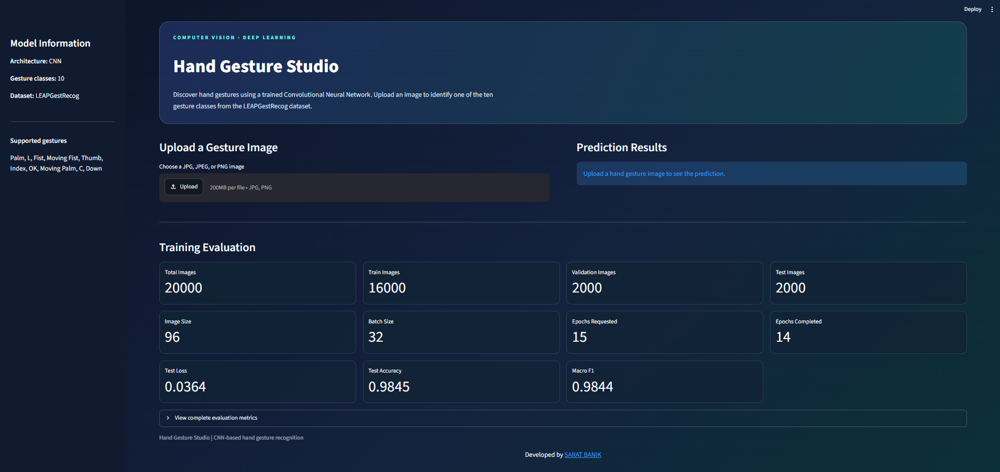
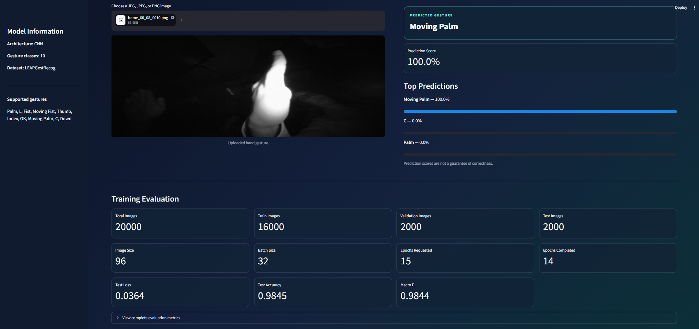
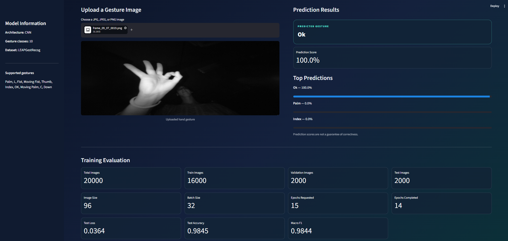
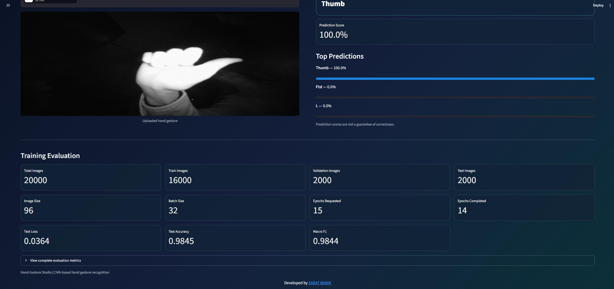
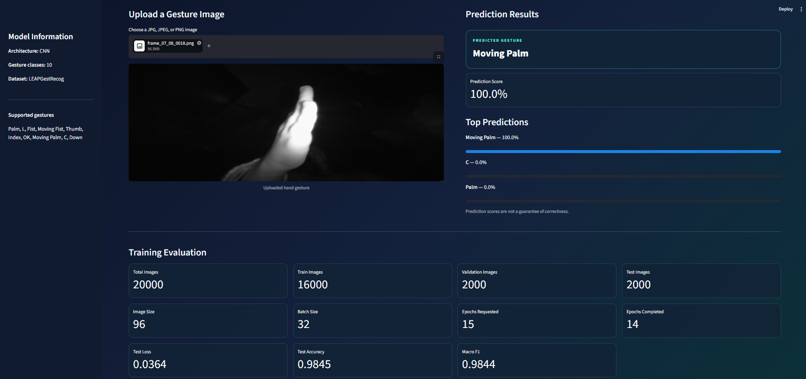

# Hand Gesture Recognition Model

A deep learning project that recognizes and classifies hand gestures using a Convolutional Neural Network (CNN). Built with Python, TensorFlow, and Streamlit, the project provides image-based gesture prediction, model evaluation, and an optional webcam demonstration.

## Project Overview

Hand gesture recognition enables natural, touch-free interaction between humans and computers. This project uses the LEAPGestRecog dataset to train a CNN to recognize ten gesture categories from images.

The application allows users to upload an image, view the predicted gesture, and inspect prediction scores through a web-based interface.

## Features

- Classifies 10 different hand gesture categories.
- Uses a CNN implemented with TensorFlow and Keras.
- Preprocesses images through resizing, grayscale conversion, and normalization.
- Splits data by subject to reduce data leakage.
- Generates training history, a confusion matrix, and evaluation metrics.
- Supports command-line image prediction.
- Provides an interactive Streamlit web application.
- Includes an optional OpenCV webcam demonstration.

## Application Screenshots

### 1. Dashboard Overview

The main interface provides image upload functionality, model information, and a training evaluation summary.



### 2. Moving Palm Prediction

Example prediction showing the model identifying the Moving Palm gesture.



### 3. OK Gesture Prediction

Example prediction showing the model identifying the OK gesture.



### 4. Thumb Gesture Prediction

Example prediction showing the model identifying the Thumb gesture.



### 5. Training Evaluation and Prediction Results

The dashboard displays evaluation metrics alongside gesture predictions.



## Gesture Categories

| Dataset Label | Gesture |
|---|---|
| `01_palm` | Palm |
| `02_l` | L |
| `03_fist` | Fist |
| `04_fist_moved` | Moving Fist |
| `05_thumb` | Thumb |
| `06_index` | Index |
| `07_ok` | OK |
| `08_palm_moved` | Moving Palm |
| `09_c` | C |
| `10_down` | Down |

## Dataset

This project uses the **LEAPGestRecog dataset**.

- **Source:** [LEAPGestRecog on Kaggle](https://www.kaggle.com/datasets/gti-upm/leapgestrecog)
- **Task:** Hand gesture image classification
- **Classes:** 10
- **Format:** Images organized by subject and gesture category

Download and extract the dataset into the project's `data/` directory before training. Do not commit the complete dataset to GitHub.

## Technologies Used

| Technology | Purpose |
|---|---|
| Python | Main programming language |
| TensorFlow / Keras | CNN training and inference |
| NumPy | Numerical processing |
| Pillow | Image loading and conversion |
| Scikit-learn | Model evaluation |
| Matplotlib | Training and evaluation plots |
| Streamlit | Web application |
| OpenCV | Webcam capture and display |

## Project Structure

```text
Hand-Gesture-Recognition-Model/
│
├── app.py
├── train_model.py
├── dataset_utils.py
├── predict_image.py
├── webcam_demo.py
├── requirements.txt
├── README.md
├── PROJECT_REPORT.md
│
├── assets/
│   └── images/
│       ├── 01-dashboard-overview.png
│       ├── 02-moving-palm-prediction.png
│       ├── 03-ok-gesture-prediction.png
│       ├── 04-thumb-gesture-prediction.png
│       └── 05-training-evaluation.png
│
├── data/
│   └── leapGestRecog/
│
└── artifacts/
    ├── hand_gesture_model.keras
    ├── best_validation_model.keras
    ├── class_names.json
    ├── metrics.json
    ├── confusion_matrix.png
    └── training_history.png
```

The dataset's exact folder nesting can vary depending on the extraction process. Model and evaluation files in `artifacts/` are generated during training.

## Installation and Setup

### 1. Clone the repository

```bash
git clone https://github.com/saratbanik/Hand-Gesture-Recognition-Model.git
cd Hand-Gesture-Recognition-Model
```

### 2. Create a virtual environment

```bash
python -m venv venv
```

Activate it in Windows PowerShell:

```powershell
.\venv\Scripts\Activate.ps1
```

### 3. Install dependencies

```bash
python -m pip install --upgrade pip
python -m pip install -r requirements.txt
```

Use a Python version compatible with the TensorFlow version specified in `requirements.txt`.

### 4. Prepare the dataset

Download the LEAPGestRecog dataset from Kaggle, extract it, and place the dataset inside `data/`.

## Model Training

Run:

```bash
python train_model.py
```

The training script prepares the dataset, trains the CNN, evaluates the model, and saves the trained model and evaluation outputs under `artifacts/`.

Training time depends on the hardware and dataset size.

## Run the Web Application

Start Streamlit:

```bash
python -m streamlit run app.py
```

Open the local URL shown in the terminal, typically:

`http://localhost:8501`

Upload a JPG, JPEG, or PNG image to view the predicted gesture and its scores.

The trained model and supporting files must exist in `artifacts/` before using the application.

## Predict a Gesture from an Image

Run the command-line prediction script:

```bash
python predict_image.py --image "C:\path\to\your\gesture.png"
```

Replace the example path with the actual image path on your computer.

## Optional Webcam Demonstration

Run:

```bash
python webcam_demo.py
```

To select another camera:

```bash
python webcam_demo.py --camera 1
```

Press **Q** in the webcam window to exit.

**Limitation:** LEAPGestRecog images come from a different sensing environment than ordinary RGB webcam images. Predictions from a standard webcam may therefore be inaccurate.

## Model Evaluation

The training run recorded the following results:

| Metric | Result |
|---|---:|
| Total images | 20,000 |
| Training images | 16,000 |
| Validation images | 2,000 |
| Test images | 2,000 |
| Test loss | 0.0364 |
| Test accuracy | 98.45% |
| Macro F1-score | 98.44% |
| Epochs completed | 14 of 15 |

These results are from the reported training run; future training runs may produce different values.

The project also generates:

- `metrics.json` — evaluation metrics and training configuration
- `confusion_matrix.png` — predicted versus actual classes
- `training_history.png` — training and validation curves
- `hand_gesture_model.keras` — saved trained model

## Limitations

- Performance depends on the training data and preprocessing.
- Changes in lighting, orientation, background, and camera type may affect predictions.
- High test performance does not guarantee the same performance on images from other environments.
- The webcam demonstration is experimental and is not intended for safety-critical systems.

## Future Improvements

- Improve performance on images captured by ordinary RGB cameras.
- Add hand detection or segmentation before classification.
- Explore data augmentation and alternative CNN architectures.
- Optimize inference speed for real-time applications.
- Integrate gesture recognition with accessibility tools and smart-device interfaces.

## Potential Applications

- Gesture-based human-computer interaction
- Touch-free interface control
- Accessibility-oriented interfaces
- Educational computer vision projects
- Experimental smart-device control

---

<div align="center">

**Developed by [SARAT BANIK](https://www.linkedin.com/in/saratbanik)**

</div>
